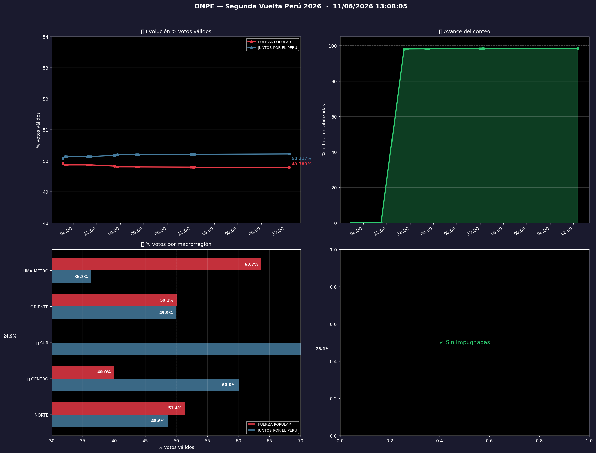

# Proyección electoral ONPE — Segunda Vuelta Perú 2026

Herramienta en Python que consulta en tiempo real la API pública de resultados de la ONPE durante el conteo de la segunda vuelta presidencial 2026, analiza los resultados por región y macrorregión, y proyecta el resultado final de las regiones cuyo conteo aún no estaba completo.



## Qué hace

El script principal, `onpe_analisis_electoral.py`, realiza en cada ejecución:

1. **Detecta el proceso electoral activo** consultando la API de la ONPE.
2. **Obtiene los resultados nacionales y del extranjero** por separado: votos válidos, porcentajes, avance de actas y actas pendientes.
3. **Consulta los 25 departamentos** (incluido el Callao) y los agrupa en cinco macrorregiones: Norte, Centro, Sur, Oriente y Lima Metropolitana.
4. **Proyecta el resultado** de cada región con conteo incompleto.
5. **Guarda un snapshot** en un historial CSV, lo que permite seguir la evolución del conteo en el tiempo.
6. **Genera un panel de cuatro gráficos**: evolución del porcentaje de votos, avance del conteo, resultados por macrorregión y actas impugnadas por región.

Además, muestra en la terminal tablas formateadas con resultados por región y macrorregión, quién lidera y las regiones donde la diferencia es muy estrecha.

## Método de proyección

Para cada región con más del 10 % de actas contabilizadas, los votos finales de cada candidato se estiman como:

```
votos_proyectados = votos_actuales / (avance / 100)
```

Es decir, se asume que las actas que faltan contar en esa región tendrán la misma distribución de votos que las ya contabilizadas. Las regiones por debajo del 10 % de avance no se proyectan porque la muestra es demasiado pequeña.

## Limitaciones

- **La proyección asume que las actas pendientes son homogéneas con las contadas.** En la práctica, las actas de zonas rurales o alejadas suelen llegar más tarde y pueden votar distinto, lo que introduce un sesgo que este método no corrige.
- **El voto del extranjero no se proyecta**, solo se muestra el avance actual.
- **Las actas impugnadas se reportan, pero no se modelan**: no se estima cómo podrían cambiar el resultado.
- **La proyección es puntual, sin intervalos de confianza.**
- **Depende de endpoints no documentados de la ONPE**, que estaban activos durante el conteo y pueden haber cambiado o dejado de funcionar.

## Datos incluidos

- `data/onpe_historial.csv`: evolución del resultado nacional, una fila por consulta, con marca de tiempo completa.
- `data/snapshots/onpe_regional_HHMMSS.csv`: resultados por departamento en cada consulta. El nombre del archivo indica la hora de la captura.

Estos datos se conservan porque la API solo muestra el estado actual del conteo: los snapshots son el único registro de cómo fue evolucionando.

## Estructura

| Archivo | Descripción |
|---|---|
| `onpe_analisis_electoral.py` | Script principal: consulta, análisis regional, proyección, historial y gráficos |
| `onpe_proyeccion.py` | Módulo de proyección |
| `onpe_probabilidad.py` | Estimación probabilística del resultado |
| `onpe_impugnados.py` | Análisis de actas impugnadas |

## Instalación y uso

```bash
pip install -r requirements.txt
```

```bash
# Una sola consulta
python onpe_analisis_electoral.py

# Actualizar automáticamente cada 90 segundos
python onpe_analisis_electoral.py --intervalo 90

# Filtrar una región
python onpe_analisis_electoral.py --region Junín

# Sin generar gráficos
python onpe_analisis_electoral.py --sin-graficos
```

## Tecnologías

Python · pandas · NumPy · Matplotlib · curl_cffi · tabulate · colorama

## Fuente de datos

Resultados oficiales publicados por la [ONPE](https://resultadosegundavuelta.onpe.gob.pe/) (Oficina Nacional de Procesos Electorales del Perú). Este proyecto es independiente y no está afiliado a la ONPE.
